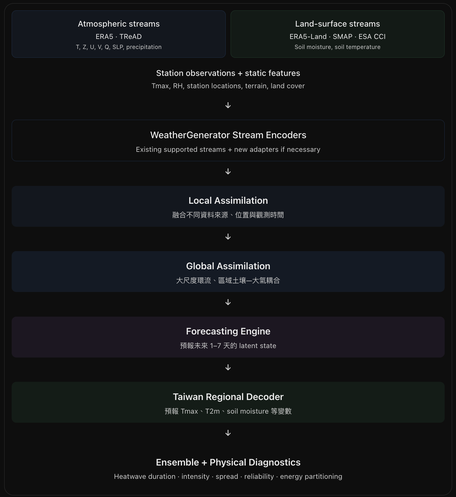
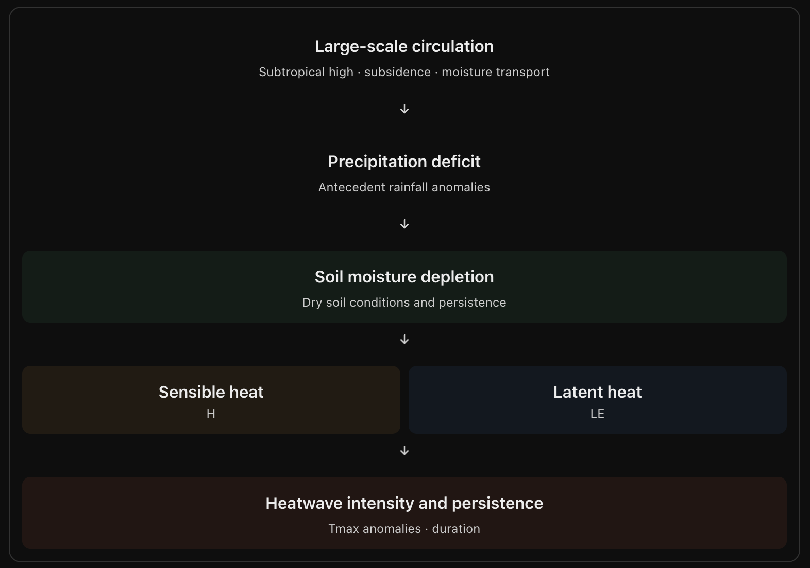

# WeatherGenerator：台灣多來源熱浪系集預報的架構與設定建議

針對你的提案 Multisource Heatwave Ensemble Prediction over Taiwan: Added Value of Soil Moisture and Physical Consistency，我建議採用：

Pretrained WeatherGenerator + Multisource Assimilation + Regional Forecast Decoder + Ensemble Generation

不過，與先前的 ERA5 → WRF 降尺度不同，這次的核心是 熱浪的時間演變、土壤濕度記憶，以及系集預報的不確定性。因此不能只把它當作空間降尺度問題。

我會將實驗分成兩個階段：

1. Hackathon proof of concept：使用 WeatherGenerator 已支援的資料路徑，建立大氣基準模型，再加入土壤濕度，檢驗其對熱浪預報的增益。
2. 後續研究：整合衛星與測站觀測、擴充預報系集，並使用物理診斷檢查土壤—大氣交互作用。

## 1. 建議的整體架構

這是建議的研究架構，並不代表 WeatherGenerator 目前已經原生支援所有資料來源、預報步長或系集產生方式。

## 2. Local / Global Attention 應該如何設定？

這次與降尺度最大的不同，是熱浪預報需要同時掌握大尺度環流與局部陸面狀態。

### Local Attention：整合土壤濕度與局部觀測

例如台灣中南部某個 HEALPix cell 內，可能包含 ERA5-Land soil moisture、SMAP 土壤濕度、測站溫度及 TReAD 的地面變數。

Local Assimilation 的工作是整合這些不同來源的資訊，產生局部 latent representation。

但有一個關鍵限制：HEALPix cell 太粗時，單一 cell 可能同時包含山區、平原和海域。

因此我建議保留 pretrained HEALPix level，再利用細尺度座標、地形與 land mask 進行 target decoding，而不是為了台灣直接改動 backbone 的 HEALPix resolution。

### Global Attention：整合熱浪相關環流

熱浪可能受到西太平洋副熱帶高壓、下沉運動、雲量與輻射條件、前期降雨，以及水氣輸送等因素影響。

這些現象的空間尺度通常超過台灣本島，因此我不建議把大氣輸入限制在台灣。

建議的空間範圍

| 資料                | 建議輸入範圍             | 用途          |
| ----------------- | ------------------ | ----------- |
| ERA5              | 100–140°E, 5–40°N  | 大尺度環流與熱浪背景  |
| ERA5-Land         | 119–123°E, 21–26°N | 台灣及周邊陸地土壤狀態 |
| TReAD             | 台灣原始區域             | 高解析度地表資訊    |
| SMAP / ESA CCI    | 台灣陸地               | 土壤濕度觀測      |
| Synoptic stations | 台灣測站               | 地面溫度與濕度觀測   |
| Prediction target | 台灣陸地               | 熱浪預報及評估     |

這些範圍是建議實驗設定，不是官方已驗證的最佳配置。

對 ERA5，我會額外做一組 110–130°E、15–30°N 的比較，確認擴大 domain 是否真的帶來增益。

### Attention 超參數

| 參數                              | 建議                                   |
| ------------------------------- | ------------------------------------ |
| `healpix_level`                 | 沿用 pretrained checkpoint             |
| `ae_local_num_queries`          | 沿用 pretrained checkpoint             |
| `ae_global_att_dense_rate`      | 沿用 pretrained checkpoint             |
| `ae_aggregation_att_dense_rate` | 沿用 pretrained checkpoint             |
| `forecast_att_dense_rate`       | 初期沿用 checkpoint，並確認 forecast mode 相容 |
| `fe_num_blocks`                 | 使用 checkpoint 相容的 forecasting 設定     |
| `with_flash_attention`          | GPU 支援時啟用                            |

我不建議在 proof of concept 同時調整這些參數，因為會難以區分改善來自 soil moisture，還是來自 architecture change。

目前原始碼已包含 `ForecastingEngine`，並使用 `forecast_att_dense_rate`、`fe_num_blocks` 等設定；但是否能直接做 1–7 天預報，仍需要確認 checkpoint 的 forecasting policy 和訓練配置。
([engines.py](https://github.com/ecmwf/WeatherGenerator/blob/develop/src/weathergen/model/engines.py) &
[model.py](https://github.com/ecmwf/WeatherGenerator/blob/develop/src/weathergen/model/model.py))

## 3. 土壤濕度的時間記憶應如何表示？

這是整個研究最關鍵的部分。

如果只提供預報起始日的 soil moisture：

$$ \text{SM}(t_0) $$

模型可以利用當天的乾濕狀態，但不一定能區分「剛開始變乾」與「已經持續乾旱三週」。

我建議使用多個前期時間尺度：

$$ X_{\mathrm{land}} = \left[ \text{SM}(t_0), \overline{\text{SM}}_{7\text{d}}, \overline{\text{SM}}_{30\text{d}}, P_{\mathrm{antecedent}} \right] $$

其中：

- $\text{SM}(t_0)$：初始土壤濕度。
- $\overline{\text{SM}}_{7\text{d}}$：前 7 天平均土壤濕度。
- $\overline{\text{SM}}_{30\text{d}}$：前 30 天平均土壤濕度。
- $P_{\mathrm{antecedent}}$：前期累積降雨。

這些可以作為額外 channels，或透過 WeatherGenerator 支援的多時間步輸入路徑整合。

\*\*但要特別注意：\*\*不能直接假設所有時間統計量都能加入既有 pretrained stream。新增 channels 可能改變 embedding 維度，必須建立新的 stream adapter，或使用相容的初始化方式。

### 是否要加入 sensible / latent heat flux？

我建議先將它們作為診斷變數，而不是主要輸入。

原因是你想研究 soil moisture 是否透過地表能量分配影響熱浪。如果一開始就把 latent heat flux 和 sensible heat flux 當成額外輸入，可能讓模型繞過 soil moisture 的作用，使實驗不容易解釋。

你可以在第二階段再加入 flux variables，做獨立的 ablation。

## 4. 如何設計 Soil Moisture Added Value 實驗？

我建議把實驗設計成配對比較：同一個模型架構、相同起報時間、相同預報步長、相同驗證資料，只改變 soil moisture 資訊。

| 實驗 | Atmospheric | Soil moisture        | 目的                      |
| -- | ----------- | -------------------- | ----------------------- |
| A0 | ERA5        | 不提供新增 SM stream      | 大氣 baseline             |
| A1 | ERA5        | ERA5-Land SM         | 測試土壤濕度增益                |
| A2 | ERA5        | ERA5-Land + SMAP     | 測試衛星觀測增益                |
| A3 | ERA5        | ERA5-Land + ESA CCI  | 比較衛星產品                  |
| A4 | ERA5        | ERA5-Land + 7/30 天記憶 | 測試 soil moisture memory |

其中 A0 的定義需要非常嚴謹。

如果 pretrained WeatherGenerator 的 ERA5 stream 本來就包含 soil moisture 或與土壤狀態高度相關的變數，那麼 A0 不是完全不含土壤資訊的 baseline。

另外，TReAD 和測站也可能間接包含乾旱訊號。因此正式比較時，必須列出各實驗的所有 channels，避免宣稱移除了 soil moisture，實際上卻透過其他來源保留相同資訊。

\*\*最重要的設計原則：\*\*新增 soil moisture 時，除了 soil moisture stream 以外，其他輸入應保持一致。

### 避免資料洩漏

所有輸入都必須在預報起始時間 $t_0$ 已經可用。

例如預報未來第 5 天熱浪時，不能使用第 5 天的 ERA5 reanalysis、TReAD 或事後處理的衛星產品作為輸入。

歷史 reanalysis 可以用於 retrospective experiments，但應區分「理想化 hindcast」與「真正可操作的即時預報」。

尤其 ERA5-Land、SMAP 和 ESA CCI 的資料發布延遲不同，不能假設它們在同一時間全部可用。

## 5. Ensemble Prediction：我會如何設計？

WeatherGenerator 的原始碼包含 `EnsPredictionHead`，並透過各 stream 的 `pred_head.ens_size` 設定 ensemble output size。([model.py](https://github.com/ecmwf/WeatherGenerator/blob/develop/src/weathergen/model/model.py))

但這不代表只要把 `ens_size` 從 1 改成 16，就能得到經過校準、具有合理 ensemble spread 的機率預報。還需要確認訓練損失、ensemble member 的產生方式，以及 checkpoint 是否支援相應設定。

### 建議分兩階段

階段一：Deterministic forecasting

先產生單一預報，確認模型是否能預測 Tmax、熱浪發生機率的基礎訊號，以及 soil moisture 的增益。

這個階段優先處理預報偏差、時間演變與 fine-tuning 穩定性。

階段二：Probabilistic ensemble forecasting

先以 8 members 作為實驗目標，若程式與計算資源允許，再測試 16 members。

優先使用官方已支援的 ensemble training / inference workflow；若沒有相容 checkpoint，就需要額外訓練或採用明確定義的 ensemble generation 方法。

### 建議的預報設定

| 項目                      | 初始設定                                         |
| ----------------------- | -------------------------------------------- |
| Forecast initialization | 每日 00 UTC                                    |
| Forecast horizon        | Day 1–7                                      |
| Temporal resolution     | Daily Tmax                                   |
| Ensemble size           | 先 8，再 16                                     |
| Main output             | Tmax                                         |
| Auxiliary output        | T2m、soil moisture（可選）                        |
| Training loss           | MSE/MAE baseline，系集再加入 proper scoring rule   |
| Evaluation              | CRPS、Brier Score、Rank Histogram、Spread–Skill |

這些是實驗目標，不代表目前 WeatherGenerator 已有現成的 daily Tmax 7-day ensemble checkpoint。

若採用 ensemble training，可以考慮 CRPS：

$$ \mathrm{CRPS} = \frac{1}{M}\sum_{m=1}^{M}|x_m-y| - \frac{1}{2M^2}\sum_{m=1}^{M}\sum_{n=1}^{M}|x_m-x_n| $$

其中 $M$ 是 ensemble members 數量。

CRPS 可以同時評估 ensemble 的準確性與機率分布品質，但實際訓練時仍需要確認 WeatherGenerator 的 loss interface 是否支援。

## 6. 熱浪定義與驗證指標

我建議將 daily Tmax 當作主要預報變數，並從 Tmax 計算 heatwave diagnostics，而不是一開始就直接預測 heatwave index。

例如可以定義：

$$ HW(t)= \begin{cases} 1, & T_{\max}(t)>T_{90}(d)\\ 0, & \text{otherwise} \end{cases} $$

其中 $T_{90}(d)$ 是依據歷史資料、以年內日期 $d$ 定義的 Tmax 第 90 百分位門檻。

若連續至少 3 天超過門檻，就定義為一次熱浪事件。這只是建議的研究定義，正式實驗應與 Lin et al. (2025) 的定義保持一致，或另外進行敏感度測試。

### Evaluation framework

| 類別                   | 指標                                 | 研究目的         |
| -------------------- | ---------------------------------- | ------------ |
| Temperature          | RMSE、MAE、Bias                      | Tmax 準確性     |
| Heatwave frequency   | Frequency bias                     | 是否高估或低估事件頻率  |
| Heatwave intensity   | Tmax anomaly、maximum intensity     | 是否掌握極端高溫     |
| Heatwave duration    | Duration error、event detection     | 是否能預測持續性     |
| Spatial structure    | Pattern correlation、FSS            | 熱浪空間分布       |
| Ensemble quality     | CRPS、Brier Score                   | 機率預報品質       |
| Ensemble reliability | Rank histogram、reliability diagram | Spread 與校準程度 |

其中 duration 特別重要，因為你的研究假說是土壤濕度記憶可能影響熱浪的持續性，不只是單日 Tmax。

對 7 天預報而言，事件長度會受到 forecast window 截斷影響。建議同時評估完整可觀測的熱浪事件，以及固定 7 天視窗內的連續高溫日數。

## 7. Physical Consistency：如何驗證土壤—大氣交互作用？

這是我認為提案最有研究價值的部分。

單純證明加入 soil moisture 後 RMSE 下降，還不足以證明模型學到合理的物理過程。

你可以使用 Lin et al. (2025) 已發表的診斷方法，檢查下列關係。

研究假說的概念路徑；實際關係可能受季節、地形、植被與大氣條件調節，不能僅由相關性推論因果。

### 建議三項核心診斷

A. Soil moisture–temperature coupling

計算前期 soil moisture anomaly 與後續 Tmax anomaly 的相關性：

$$ r(\mathrm{SM}_{t-k},T_{\max,t}) $$

並比較 observation、atmospheric baseline 和 atmosphere + soil moisture 三者的關係。

B. Evaporative fraction

若資料有 sensible heat flux $H$ 與 latent heat flux $\text{LE}$，可以計算：

$$ \text{EF} = \frac{\text{LE}}{H + \text{LE}} $$

需統一通量正負號，並對分母過小或非日間條件做適當處理。

比較乾土壤與濕土壤條件下的 EF，以及其與 Tmax 的關係。

但要注意：若模型沒有預測 H 和 LE，就不能宣稱模型預測的 energy partitioning 已通過驗證。 最多只能透過參考資料檢查相關環境條件，或額外訓練 flux output heads。

C. Conditional heatwave skill

將預報依照初始土壤濕度分組，例如：

- Dry soil：SM anomaly 低於第 20 百分位。
- Normal soil：第 20–80 百分位。
- Wet soil：高於第 80 百分位。

再比較不同組別的 Tmax、heatwave duration、CRPS 和 Brier Score。

這可以直接回答：

加入 soil moisture 後，模型是否特別改善乾旱背景下的熱浪預報？

建議進一步依環流型態或季節分層，避免把大氣環流造成的共同變化誤判成 soil moisture 的獨立作用。

## 8. Hackathon 期間的實際工作範圍

我不建議三天內同時完成所有五種資料來源、7 天 ensemble forecasting，以及完整物理診斷。

比較可行的規劃如下。

| 時間    | 主要工作                                                          | 預期成果                   |
| ----- | ------------------------------------------------------------- | ---------------------- |
| Day 1 | 確認 checkpoint、stream interface、forecast mode，建立 ERA5 baseline | 可以執行的 Tmax prediction  |
| Day 2 | 加入 ERA5-Land soil moisture，訓練或 fine-tune 相容模組                 | A0 vs A1               |
| Day 3 | 比較 Tmax、heatwave skill、SM conditional skill，若支援則評估 ensemble   | 初步 added-value results |

SMAP、ESA CCI 和 station observations 建議作為後續擴充，除非你在 hackathon 前就已經完成資料前處理與 stream adapter。

## 9. 最終推薦設定

Taiwan Heatwave PoC — Configuration

| Backbone            | Pretrained WeatherGenerator            |
| ------------------- | -------------------------------------- |
| Atmospheric input   | ERA5，東亞區域                              |
| Land input          | ERA5-Land soil moisture                |
| Temporal memory     | Current + 7/30-day antecedent features |
| Target              | Taiwan daily Tmax                      |
| Lead times          | Day 1–7，依 checkpoint 支援程度逐步擴充          |
| Fine-tuning         | 先 decoder，必要時部分 backbone               |
| HEALPix / attention | 沿用 pretrained settings                 |
| Ensemble            | 目標 8–16 members                        |
| Primary comparison  | ERA5 vs ERA5 + soil moisture           |

### 與 WeatherGenerator 官方應用的關聯

你的提案結合了兩個已公開的 [Weather Generator](https://weathergenerator.eu/about/) 研究方向：

- AP6（Météo-France）：高解析度短期 ensemble forecasting，並研究 lateral boundary conditions 與 physical consistency。
- AP13（CMCC）：氣候極端事件的時空降尺度與 ensemble 評估，包含溫度和降水極端值。

但你的研究另外強調 soil moisture memory、multisource observations 和 land–atmosphere coupling，因此具有不同的研究重點。

### 我認為最需要先確認的三件事

1. Forecasting checkpoint：是否已有能直接 fine-tune 的多日預報模型？如果只有短期 forecasting checkpoint，7 天預報可能超出三天 hackathon 的可行範圍。
2. Soil moisture stream：目前 WeatherGenerator 是否已有相容的 ERA5-Land 或其他 soil moisture stream？新增資料來源是否需要修改 data loader 和 embedding network？
3. Ensemble generation：現有 `EnsPredictionHead` 的訓練方式是否能提供有意義的 probabilistic forecast，而不只是多個未校準輸出？

這三點會決定 PoC 的實際工作量。

整體而言，我最推薦先完成「相同 WeatherGenerator backbone 下，ERA5-only 與 ERA5 + ERA5-Land soil moisture 的配對比較」，再逐步擴充到多來源 ensemble prediction。 這樣能直接檢驗你的主要研究假說，也比較容易產生可解釋、可重現的結果。

另外，若你能提供目前的 WeatherGenerator `config.yaml`、checkpoint 資訊及 Lin et al. (2025) 的診斷方法，我可以進一步將上述設計對應到實際的 stream、forecast、prediction head 與 loss 設定，而不只是概念架構。