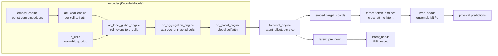
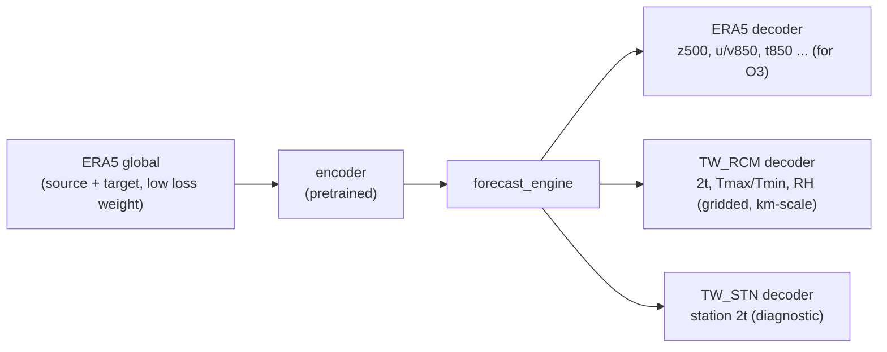

# Fine-tuning WeatherGenerator: general guide and Taiwan heatwave workflow

> Checked against `develop` @ `88563e5f` (2026-10-27). Line links point to that revision.

This guide has two parts:

- **Part I (§1–§3)** is the general mechanics: how fine-tuning works, what each model part does, and how to freeze or train it.
- **Part II (§4)** applies this to the project *AI-Based Heatwave Ensemble Generation and Prediction over Taiwan*. Its three objectives are:
  - **O1:** fine-tune WeatherGenerator with regional climate and observational data.
  - **O2:** generate heatwave ensembles and measure intensity, frequency, duration and prediction uncertainty.
  - **O3:** identify the atmospheric circulation patterns that drive heatwaves.

---

# Part I: Mechanics

## 1. How it works

There is no separate fine-tuning code path. Fine-tuning is a normal training run with two changes:

1. **Load pretrained weights** with `train_continue --from-run-id <ID>` or `load_chkpt.run_id`.
2. **Freeze what you don't want to train** with the config key `freeze_modules`, which is a regex.

`freeze_modules` is used in two places:

- [model_interface.py:L63-68](file:///Users/bentian/Workspace/WeatherGenerator/src/weathergen/model/model_interface.py): sets `requires_grad=False` on every parameter of each matching module.
- [trainer.py:L452](file:///Users/bentian/Workspace/WeatherGenerator/src/weathergen/train/trainer.py#L452): puts matching modules in `eval()` mode every mini-epoch, which turns off their dropout.

Frozen parameters never get a gradient, so AdamW skips them (no updates and no weight decay). DDP ignores them too.

Both launch paths load weights through the same function with `strict=False` ([model_interface.py:L211](file:///Users/bentian/Workspace/WeatherGenerator/src/weathergen/model/model_interface.py#L211), [L250-259](file:///Users/bentian/Workspace/WeatherGenerator/src/weathergen/model/model_interface.py#L250-L259)):
- New modules, such as a decoder for a new stream, keep their random initialisation.
- Modules that are no longer built are reported as "unused keys".
- **Shape mismatches still raise an error.**

### Matching rules ([apply_fct_to_blocks](file:///Users/bentian/Workspace/WeatherGenerator/src/weathergen/model/utils.py#L38-L51))

```python
name = module.name if hasattr(module, "name") else name   # dotted path otherwise
if re.fullmatch(blocks, name) and name != "": fct(module)
```

- The match is **`re.fullmatch`**, so wrap patterns in `.*…*`. For example, `encoder` only matches the exact top-level module, while `.*encoder.*` matches everything under it.
- Freezing a parent freezes all of its children.
- If a module has a `.name` attribute, the regex is tested against that name instead of its dotted path. These modules have one:
  - `StreamEmbedder_<stream>`
  - `embed_target_coords_<stream>`
  - `TargetPredictionEngine_<stream>`
  - `EnsPredictionHead_<stream>`
  - `BilinearDecoder_<stream>`
- `""` (the default) freezes nothing.

## 2. Model parts in detail

### 2.0 Data flow

The model is built in [Model.create](file:///Users/bentian/Workspace/WeatherGenerator/src/weathergen/model/model.py#L373-L582) and run in [Model.forward](file:///Users/bentian/Workspace/WeatherGenerator/src/weathergen/model/model.py#L673-L710):



Overall:
- The **encoder** maps observations to a global latent grid with one set of tokens per HEALPix cell.
- The **forecast engine** steps that latent state forward in time.
- The **decoder** reads the latent state at arbitrary target coordinates and returns physical values.

The non-trainable tensors in `ModelParams` (`pe_embed`, `pe_global`, RoPE coords, `hp_nbours`) live outside `model`. They are never optimised and never need freezing.

Key dimensions used below:

| Symbol | Config key | Meaning |
|---|---|---|
| `D_loc` | `ae_local_dim_embed` | width of local (per-cell) tokens |
| `D_glob` | `ae_global_dim_embed` | width of the global latent; shared by encoder, forecast engine and decoder |
| `Q` | `ae_local_num_queries` | latent tokens per HEALPix cell |
| `N_cells` | `12·4^healpix_level` | number of HEALPix cells (default level 5: 12,288 cells of about 1.8°) |

> [!NOTE]
> Engine classes declare `name: "EncoderModule"` as a *type annotation*, not an assignment, so they have no `.name` attribute. `freeze_modules` therefore matches them by **dotted path** (e.g. `encoder.ae_global_engine`). Only the stream-specific modules listed in §1 match by `.name`.

---

### 2.1 Encoder: `encoder` ([encoder.py](file:///Users/bentian/Workspace/WeatherGenerator/src/weathergen/model/encoder.py))

Freeze it all with `.*encoder.*`. It runs in five stages:

#### a) Stream embedders: `encoder.embed_engine.embeds[<stream>]`
- **Code:** [EmbeddingEngine](file:///Users/bentian/Workspace/WeatherGenerator/src/weathergen/model/engines.py#L36-L201).
- **What it does:** one network per input stream (ERA5, IASI, SYNOP, …). It maps raw patches of `token_size` observations × channels into `D_loc` tokens. It then reorders tokens so tokens from the same cell are contiguous, and adds per-cell positional encodings.
- **Variants** (stream config `embed.net`):
  - `transformer`: a small transformer ([StreamEmbedTransformer](file:///Users/bentian/Workspace/WeatherGenerator/src/weathergen/model/embeddings.py#L21-L132)) controlled by `embed.num_blocks`, `num_heads` and `dim_embed`.
  - `linear`: a single projection (`StreamEmbedLinear`).
- **Dropout:** `embed_dropout_rate` inside the blocks, plus **`embed_final_dropout_rate`** (new in #2964, default `0.1`) on the output ([engines.py:L67-68](file:///Users/bentian/Workspace/WeatherGenerator/src/weathergen/model/engines.py#L67-L68)).
- **Streams without an embedder:** streams with `diagnostic: True` or no source channels get `Identity`, which has no parameters. They are target-only.
- **Names:** the module path is `encoder.embed_engine.embeds.<stream>`, and each embedder has the `.name` `StreamEmbedder_<stream>`.
- **Regex:**
  - All embedders: `.*embed_engine.*`.
  - One stream: `StreamEmbedder_ERA5`.
- **When to train it:** when you add a new input stream, or its channels or normalisation change. This is the part most tied to the input data. If you add a new stream, its embedder is missing from the checkpoint and starts from random weights.
- **Shape constraint:** the input size depends on the stream's channel count, geoinfo count and `token_size`. Changing any of these for an existing stream gives a shape mismatch when the checkpoint loads.

#### b) Local assimilation: `encoder.ae_local_engine`
- **Code:** [LocalAssimilationEngine](file:///Users/bentian/Workspace/WeatherGenerator/src/weathergen/model/engines.py#L204-L245).
- **What it does:** `ae_local_num_blocks` × (varlen self-attention + MLP) at width `D_loc`. Attention stays **inside each HEALPix cell**: tokens from all streams in a cell attend to each other, which fuses the different observation types locally.
- **Config:** `ae_local_num_blocks`, `ae_local_num_heads`, `ae_local_dropout_rate`, `ae_local_with_qk_lnorm`.
- **Regex:** `.*ae_local_engine.*`. Note that `.*local.*` matches this **and** the adapter below.
- **When to train it:** together with the embedders when the input mix changes, e.g. a new sensor that must be fused with existing ones.

#### c) Local→global adapter: `encoder.ae_local_global_engine`
- **Code:** [Local2GlobalAssimilationEngine](file:///Users/bentian/Workspace/WeatherGenerator/src/weathergen/model/engines.py#L248-L317) (`ae_adapter_type: cross_attention`, the default) or [Local2GlobalSumEngine](file:///Users/bentian/Workspace/WeatherGenerator/src/weathergen/model/engines.py#L320-L374) (`ae_adapter_type: sum`).
- **What it does:** compresses a variable number of local tokens per cell into a fixed `Q` tokens of width `D_glob`.
  - The cross-attention variant uses `q_cells` as queries and the cell's local tokens as keys and values, interleaved with MLPs (`ae_adapter_num_blocks`).
  - The sum variant sums the cell's tokens, then applies a linear projection and MLPs.
- **Config:** `ae_adapter_embed`, `ae_adapter_num_heads`, `ae_adapter_num_blocks`, `ae_adapter_with_residual`, `ae_adapter_dropout_rate`.
- **Regex:** `.*ae_local_global.*`. It is also matched by `.*local.*`, `.*global.*` and `.*adapter.*` (via `ae_adapter`).
- **Fine-tuning note:** this is the bottleneck between the observation space and the latent space. Train it together with (b) if you train (b).

#### d) Learnable queries: `encoder.q_cells`
- **What it is:** a raw `nn.Parameter` of shape `(1, Q, D_glob)`, or `(N_cells, Q, D_glob)` when `ae_local_queries_per_cell: True` ([encoder.py:L87-112](file:///Users/bentian/Workspace/WeatherGenerator/src/weathergen/model/encoder.py#L87-L112)).
- **Role:**
  - It is the initial latent state of every cell. **Masked or empty cells keep this value plus positional encoding.**
  - It also seeds the register and class tokens.
- **Freezing:** it is not a module, so the regex machinery never matches it directly. It is frozen if:
  - its parent `encoder` is frozen, or
  - the literal substring `q_cells` appears anywhere in `freeze_modules` ([model_interface.py:L67](file:///Users/bentian/Workspace/WeatherGenerator/src/weathergen/model/model_interface.py#L67)).
- **EMA:** since #2963, `q_cells` is also tracked by the EMA model. Earlier it was skipped.

#### e) Query aggregation: `encoder.ae_aggregation_engine`
- **Code:** [QueryAggregationEngine](file:///Users/bentian/Workspace/WeatherGenerator/src/weathergen/model/engines.py#L377-L453).
- **What it does:** `ae_aggregation_num_blocks` × (varlen self-attention + MLP) at width `D_glob`, applied only to the **unmasked** cell tokens plus the register and class tokens. It spreads information between observed cells before the dense global stage. Supports 2D RoPE (`rope_2D`). The default is `ae_aggregation_num_blocks: 0`, i.e. disabled.
- **Config:** `ae_aggregation_num_blocks`, `ae_aggregation_num_heads`, `ae_aggregation_mlp_hidden_factor`, `ae_aggregation_dropout_rate`.
- **Regex:** `.*ae_aggregation.*`.

#### f) Global assimilation: `encoder.ae_global_engine`
- **Code:** [GlobalAssimilationEngine](file:///Users/bentian/Workspace/WeatherGenerator/src/weathergen/model/engines.py#L456-L530).
- **What it does:** `ae_global_num_blocks` × (self-attention + MLP) over **all** `N_cells·Q` tokens (plus register and class tokens). Blocks alternate between dense and local (block-sparse, `ae_global_block_factor`) attention according to `ae_global_att_dense_rate`; the last block is always dense. There is an optional trailing LayerNorm (`ae_global_trailing_layer_norm`). Its output is the analysis latent state.
- **Config:** `ae_global_num_blocks`, `ae_global_num_heads`, `ae_global_mlp_hidden_factor`, `ae_global_dropout_rate`, `ae_global_att_dense_rate`.
- **Regex:** `.*ae_global_engine.*`. Note that `.*global.*` also matches the adapter in (c).
- **Fine-tuning note:** this is usually the largest encoder block and the most general-purpose representation. Freeze it first when GPU memory or data is limited.

---

### 2.2 Forecast engine: `forecast_engine`
- **Code:** [ForecastingEngine](file:///Users/bentian/Workspace/WeatherGenerator/src/weathergen/model/engines.py#L544-L637). It becomes `IdentityEngine` when `fe_num_blocks: 0`.
- **What it does:** a residual transformer at width `D_glob` that advances the latent state by one `forecast.time_step`. It is applied **repeatedly** for rollout steps (`forecast.num_steps`), and the decoder runs after every step. Blocks alternate between dense and local attention (`forecast_att_dense_rate`), with optional LayerNorms after given blocks (`fe_layer_norm_after_blocks`).
- **Latent noise:** `fe_impute_latent_noise_std` adds Gaussian noise scaled by the latent norm **only when `self.training` is true** ([engines.py:L624-629](file:///Users/bentian/Workspace/WeatherGenerator/src/weathergen/model/engines.py#L624-L629)). It regularises training but does **not** produce stochastic ensembles at inference (see §4.6).
- **Initialisation:** all Linear weights start at `N(0, 0.001)`, so the residual blocks begin near identity. A freshly created forecast engine therefore starts as "persistence".
- **Important:** the blocks are **only created if `training_config.forecast.policy` is not `null`** ([engines.py:L560](file:///Users/bentian/Workspace/WeatherGenerator/src/weathergen/model/engines.py#L560)).
  - A masking or SSL pretraining run with `policy: null` has an *empty* forecast engine.
  - When you fine-tune it for forecasting, these weights are missing from the checkpoint and are trained from scratch. This is expected.
- **Config:** `fe_num_blocks`, `fe_num_heads`, `fe_dropout_rate`, `fe_with_qk_lnorm`, plus `training_config.forecast.{time_step, num_steps, policy, offset, pushforward, timestep_weight}`.
  - `num_steps` may be a list that sets a curriculum over mini-epochs, e.g. `[2, 2, 4, 4, 8, 8]`.
  - `policy` is one of `fixed`, `sequential`, `random` or `sequential_random`.
- **Regex:** `.*forecast_engine.*`.
- **Fine-tuning note:** this is the main target when turning a pretrained encoder/decoder into a forecaster, as in recipe D. Longer rollouts (`num_steps`) cost a lot more memory; `pushforward: True` ([model.py:L694-695](file:///Users/bentian/Workspace/WeatherGenerator/src/weathergen/model/model.py#L694-L695)) skips gradients for all but the last step.

---

### 2.3 Decoder: three per-stream `ModuleDict`s

Decoders are built only for **non-forcing streams** ([is_stream_forcing](file:///Users/bentian/Workspace/WeatherGenerator/src/weathergen/utils/utils.py#L32), i.e. not `forcing: True`) and only when a `LossPhysical` loss is enabled ([model.py:L402-491](file:///Users/bentian/Workspace/WeatherGenerator/src/weathergen/model/model.py#L402-L491)). They run in [predict_decoders](file:///Users/bentian/Workspace/WeatherGenerator/src/weathergen/model/model.py#L735-L840).

For each target point, the decoder takes its coordinates and the latent tokens of its HEALPix cell **and its 8 neighbours** (`hp_nbours`, i.e. 9·`Q` tokens), and predicts that stream's channels.

#### a) Target-coordinate embedding: `embed_target_coords[<stream>]`
- **What it does:** maps each target point's features into the query token for the decoder, with width `embed_target_coords.dim_embed` (`D_dec`). The features are its local coordinates within the cell, **geoinfo channels** (e.g. orography, land–sea mask) and time encoding ([tokenizer_utils.py:L377-389](file:///Users/bentian/Workspace/WeatherGenerator/src/weathergen/datasets/tokenizer_utils.py#L377-L389)).
- **Variants** (stream config `embed_target_coords.net`):
  - `linear`: `NamedLinear`.
  - `mlp`: an MLP with hidden factor 8.
- **Names:** `.name` is `embed_target_coords_<stream>`.
- **Regex:** `.*embed_target_coords.*`.
- **Shape constraint:** the input size equals the stream's target coordinate feature size, which includes the number of geoinfo channels. Adding a geoinfo channel causes a shape mismatch.

#### b) Target token engine: `target_token_engines[<stream>]`
The architecture is chosen by the top-level `decoder_type`:

| `decoder_type` | Class | Blocks per layer |
|---|---|---|
| `PerceiverIOCoordConditioning` (default) | [TargetPredictionEngineClassic](file:///Users/bentian/Workspace/WeatherGenerator/src/weathergen/model/engines.py#L695-L800) | cross-attn (Q = target tokens, KV = 9-cell latent) → optional self-attn among targets (`pred_self_attention`) → MLP (AdaLN on coords if `pred_mlp_adaln`) |
| `PerceiverIO`, `AdaLayerNormConditioning`, `CrossAttentionConditioning`, `CrossAttentionAdaNormConditioning` | [TargetPredictionEngine](file:///Users/bentian/Workspace/WeatherGenerator/src/weathergen/model/engines.py#L803-L986) | different combinations of cross-attn, self-attn, AdaLN and MLP (see docstring) |
| `Linear` | [BilinearDecoder](file:///Users/bentian/Workspace/WeatherGenerator/src/weathergen/model/engines.py#L1139-L1155) | a single bilinear map (coords × latent → channels); **`pred_heads` are created but unused** |

- **Per-stream config:** `target_readout.num_layers`, `num_heads`, `mlp_hidden_factor`, `dim_head_proj`, `softcap`.
- **Dropout (new in #2964):** top-level **`pred_dropout_rate`** (default `0.1`) is used in both classes ([engines.py:L726](file:///Users/bentian/Workspace/WeatherGenerator/src/weathergen/model/engines.py#L726), [L843](file:///Users/bentian/Workspace/WeatherGenerator/src/weathergen/model/engines.py#L843)). `TargetPredictionEngine` also keeps a hard-coded `Dropout(0.2)` on the latent input. These are useful knobs against overfitting on small regional datasets.
- **Names:** `.name` is `TargetPredictionEngine_<stream>` or `BilinearDecoder_<stream>`.
- **Regex:** `.*target_token_engines.*`.
- **Fine-tuning note:** this is where the latent state is "read out". Fine-tune it when the target stream, resolution or variable set changes, or to adapt a frozen SSL encoder to physical targets (recipe A).

#### c) Ensemble prediction heads: `pred_heads[<stream>]`
- **Code:** [EnsPredictionHead](file:///Users/bentian/Workspace/WeatherGenerator/src/weathergen/model/engines.py#L640-L692).
- **What it does:** `pred_head.ens_size` independent MLPs (`pred_head.num_layers` Linear+GELU layers). Each maps `D_dec` to the stream's **channel count**, with an optional `final_activation`. Together they produce an ensemble of predictions per point, which probabilistic losses such as `kernel_crps` use.
- **Names:** `.name` is `EnsPredictionHead_<stream>`.
- **Regex:** `.*pred_heads.*`.
- **Shape constraints:**
  - The last layer's size equals the number of target channels. **Adding or removing target variables in a stream changes this layer's shape.** Give the stream a new name, or retrain the head; renaming makes the old weights "unused" and the new head start from scratch.
  - Raising `ens_size` from 1 to N is shape-safe. Member 0 (`pred_heads.0.*`) loads from the checkpoint, and members 1…N-1 are reported as missing keys and start from random weights.

#### Shared decoders (`pred_spatial_shared`)
A stream can set `pred_spatial_shared: <other_stream>` to **reuse** the other stream's `embed_target_coords` and `target_token_engines` (the same module objects), while getting its own `pred_heads` ([model.py:L493-540](file:///Users/bentian/Workspace/WeatherGenerator/src/weathergen/model/model.py#L493-L540)). This makes it cheap to add a new output stream on an existing grid: you only train its head.

---

### 2.4 SSL latent heads: `latent_pre_norm`, `latent_heads[<loss>]`
- **What they do:** used only for student-teacher losses (`LossLatentSSLStudentTeacher`: `JEPA`, `DINO`, `iBOT`).
  - `latent_pre_norm` is a LayerNorm on the step-0 latent.
  - Each head (transformer `LatentPredictionHeadTransformer`, `MLP`, or `identity`) projects class and/or patch tokens to `out_dim`.
- **Names:** `.name` is `<loss>-head`, e.g. `JEPA-head`.
- **Regex:** `.*latent_heads.*|.*latent_pre_norm.*`. `.*latent.*` matches both.
- **Fine-tuning note:** irrelevant for physical fine-tuning, so freeze them as in recipe A. They have no gradient anyway if no SSL loss is enabled. If an SSL loss is disabled in the fine-tuning config, the heads are not built at all and show up as "unused keys" when the checkpoint loads.

---

### 2.5 Quick reference

| Part | Module path | Regex | Depends on |
|---|---|---|---|
| **Encoder (all)** | `encoder` | `.*encoder.*` | |
| ├ Stream embedders | `encoder.embed_engine` | `.*embed_engine.*` / `StreamEmbedder_<s>` | input channels, geoinfo, `token_size` |
| ├ Local assimilation | `encoder.ae_local_engine` | `.*ae_local_engine.*` | `ae_local_*` |
| ├ Local→global adapter | `encoder.ae_local_global_engine` | `.*ae_local_global.*` | `ae_adapter_*` |
| ├ Learnable queries | `encoder.q_cells` | substring `q_cells` | `ae_local_num_queries` |
| ├ Query aggregation | `encoder.ae_aggregation_engine` | `.*ae_aggregation.*` | `ae_aggregation_*` |
| └ Global assimilation | `encoder.ae_global_engine` | `.*ae_global_engine.*` | `ae_global_*` |
| **Forecast engine** | `forecast_engine` | `.*forecast_engine.*` | `fe_*`, `forecast.policy` |
| **Decoder** coord embed | `embed_target_coords` | `.*embed_target_coords.*` | target coord features, geoinfo |
| **Decoder** token engine | `target_token_engines` | `.*target_token_engines.*` | `decoder_type`, `target_readout` |
| **Decoder** pred heads | `pred_heads` | `.*pred_heads.*` | target channels, `pred_head` |
| SSL latent heads | `latent_heads`, `latent_pre_norm` | `.*latent.*` | SSL loss config |
| All named modules of one stream | `*_<stream>` names | `.*_ERA5` | |

> [!WARNING]
> Watch out for broad patterns:
> - `.*global.*` and `.*local.*` both catch `ae_local_global_engine`.
> - `.*embed.*` catches the encoder's `embed_engine` **and** the decoder's `embed_target_coords`.
> - `.*ERA5.*` catches the ERA5 **encoder embedder** as well as the ERA5 **decoder**.
>
> Prefer the specific names in the tables above.

> [!IMPORTANT]
> No module is called `decoder`, so `.*decoder.*` matches nothing (except `BilinearDecoder_<stream>` when `decoder_type: Linear`). Use `.*embed_target_coords.*|.*target_token_engines.*|.*pred_heads.*`.

## 3. Step by step

### Step 1: Find the pretrained run
Note the pretrained `run_id` and, if you want one, the mini-epoch. Checkpoints are stored as `<model_path>/<run_id>/<run_id>_latest.chkpt` or `<run_id>_chkpt00012.chkpt` ([model_interface.py:L186-188](file:///Users/bentian/Workspace/WeatherGenerator/src/weathergen/model/model_interface.py#L186-L188)).

Also note the pretrained run's stream names, channel lists, geoinfo channels, `token_size` and `forecast.time_step`. You must reproduce them exactly for every stream whose weights you want to reuse.

### Step 2: Write a fine-tuning overwrite config
Create a file such as `config/my_finetune.yml`. Only include the keys you want to change. They are merged on top of the pretrained run's config.

**A) Fine-tune the decoder (and forecast engine); freeze the encoder.** This is the same setup as [config_jepa_finetuning.yml](file:///Users/bentian/Workspace/WeatherGenerator/config/config_jepa_finetuning.yml).
```yaml
freeze_modules: ".*encoder.*|.*latent_pre_norm.*|.*latent_heads.*"

general:
  istep: 0            # REQUIRED: resets LR schedule + mini-epoch counter (see Step 5)

training_config:
  num_mini_epochs: 16
  learning_rate_scheduling:
    lr_start: 1e-6
    lr_max: 5e-5      # ~5-10x smaller than pretraining
    lr_final_decay: 1e-6
    lr_final: 0.0
    num_steps_warmup: 512
    num_steps_cooldown: 512
    policy_warmup: "cosine"
    policy_decay: "constant"
    policy_cooldown: "linear"
    parallel_scaling_policy: "sqrt"
```

**B) Fine-tune the encoder; freeze the decoder.**
```yaml
freeze_modules: ".*forecast_engine.*|.*embed_target_coords.*|.*target_token_engines.*|.*pred_heads.*"
general:
  istep: 0
```

**C) Fine-tune only part of the encoder,** for example only the input embedders and the local engine for a new stream, with everything else frozen:
```yaml
freeze_modules: ".*ae_local_global.*|.*ae_aggregation.*|.*ae_global_engine.*|.*q_cells.*|.*forecast_engine.*|.*embed_target_coords.*|.*target_token_engines.*|.*pred_heads.*"
general:
  istep: 0
```

**D) Fine-tune only the forecast engine,** as in [config_forecasting_finetuning.yml](file:///Users/bentian/Workspace/WeatherGenerator/config/config_forecasting_finetuning.yml):
```yaml
freeze_modules: ".*global.*|.*local.*|.*adapter.*|.*q_cells.*|.*latent.*|.*ERA5.*"
general:
  istep: 0
training_config:
  forecast: { time_step: 06:00:00, offset: 1, num_steps: 8, policy: "fixed" }
```

**E) Full fine-tuning (nothing frozen):** set `freeze_modules: ""` and use a low `lr_max`.

> [!TIP]
> To fine-tune on new or different streams, add `streams_directory: "./config/streams/<your_dir>/"`. The streams it defines **replace** the ones inherited from the pretrained run ([config.py:L477-479](file:///Users/bentian/Workspace/WeatherGenerator/packages/common/src/weathergen/common/config.py#L477-L479)). Copy into that directory any pretrained stream you want to keep, unchanged.

### Step 3: Launch

**Option 1: `train_continue` (recommended).** It uses the pretrained run's config as the base, so the shared architecture is guaranteed to match. New streams added through `streams_directory` work here as well, because loading is `strict=False`.
```bash
uv run train_continue \
  --from-run-id <PRETRAINED_RUN_ID> \
  --mini-epoch -1 \
  --config ./config/my_finetune.yml \
  --options training_config.num_mini_epochs=16
```
- A new `run_id` is created (unless you pass `--reuse-run-id`, which you shouldn't). `run_history` records the parent run.
- Override precedence, lowest to highest: pretrained config, private config, `--config` files in order, `--options`.

**Option 2: `train` with `load_chkpt`.** This starts from a fresh config (`default_config.yml` + your files) and loads only the weights.
```bash
uv run train \
  --config ./config/my_finetune.yml \
  --options load_chkpt.run_id=<PRETRAINED_RUN_ID> load_chkpt.mini_epoch=-1
```
- Use this when you want full control over the config rather than inheriting it. Missing and unused keys are logged as warnings ([model_interface.py:L253-259](file:///Users/bentian/Workspace/WeatherGenerator/src/weathergen/model/model_interface.py#L253-L259)).
- Every hyperparameter that affects tensor shapes (`ae_*_dim_embed`, `num_heads`, `fe_num_blocks`, stream `dim_embed`, etc.) must match the pretrained model. `strict=False` does **not** tolerate shape mismatches.

On SLURM, pass the same arguments through your usual launcher script.

### Step 4: Check that the right parts are frozen
1. **Log lines:** look for `Freeze block <name>` and `Set block <name> to eval mode`. These only appear for modules that have a `.name`.
2. **Parameter table:** do a short run on one GPU without DDP. [print_num_parameters](file:///Users/bentian/Workspace/WeatherGenerator/src/weathergen/model/model.py#L593) prints the trainable count per component, and frozen parts show `0`.
3. **Checkpoint warnings:** `Missing keys` should list only modules you intended to be new. `Unused keys` should list only modules you intentionally dropped.
4. **Losses:** with the decoder frozen, validation loss before training (`validate_before_training: True`) should match the pretrained model's.

### Step 5: Pitfalls

> [!WARNING]
> **Always set `general.istep: 0` with `train_continue`.** Otherwise `istep` carries over from pretraining, and two things go wrong:
> - The LR scheduler resumes at the end of its schedule, so LR is about 0.
> - `mini_epoch_base = istep / …` ([trainer.py:L372-384](file:///Users/bentian/Workspace/WeatherGenerator/src/weathergen/train/trainer.py#L372-L384)) can exceed `num_mini_epochs`, so the training loop runs **zero** epochs.

- **`freeze_modules` is inherited.** With `train_continue`, if you don't override it you get the pretrained run's value, usually `""`.
- **`--finetune-forecast` does nothing.** The flag is defined in [cli.py:L66-73](file:///Users/bentian/Workspace/WeatherGenerator/src/weathergen/utils/cli.py#L66-L73), but [run_continue](file:///Users/bentian/Workspace/WeatherGenerator/src/weathergen/run_train.py#L119) never reads it. Use a config file instead.
- **`q_cells`** is a raw `Parameter`, not a module. It is frozen by `.*encoder.*`, or by a plain substring check for `"q_cells"` in the pattern ([model_interface.py:L67](file:///Users/bentian/Workspace/WeatherGenerator/src/weathergen/model/model_interface.py#L67)).
- **Shared decoders:** with `pred_spatial_shared`, a stream reuses another stream's `embed_target_coords` and `target_token_engines`. Freezing one freezes both.
- **Loss functions apply to every decoded stream.** `LossPhysical.loss_fcts` is not per stream ([loss_module_physical.py:L114-122](file:///Users/bentian/Workspace/WeatherGenerator/src/weathergen/train/loss_modules/loss_module_physical.py#L114-L122)). If you enable `kernel_crps`, **every** non-forcing stream needs `pred_head.ens_size ≥ 2`, or the assertion in [kernel_crps](file:///Users/bentian/Workspace/WeatherGenerator/src/weathergen/train/loss_modules/loss_functions.py#L70-L123) fails.
- **FSDP:** the shipped fine-tuning configs use `with_fsdp: False` with DDP and `ddp_find_unused_parameters: False`. Do the same unless you need FSDP for memory.
- **Learning rate:** use a `lr_max` 5–10× lower than pretraining, plus a short warmup. Frozen encoders tolerate a higher LR on the decoder than full fine-tuning does.
- **EMA validation:** if `validate_with_ema.enabled`, the EMA model loads the same checkpoint and freeze settings automatically. It now includes `q_cells` too (#2963).

---

# Part II: Taiwan heatwave ensemble workflow

## 4. Applying fine-tuning to heatwave prediction over Taiwan

### 4.1 Constraints that drive the design

| Constraint | Consequence for Taiwan |
|---|---|
| The latent grid is **global HEALPix**. At the default `healpix_level: 5`, a cell is about 1.8° across. | Taiwan (about 21.9–25.3°N, 120–122°E) covers only **about 2–4 latent cells**. Each decoder query sees a 3×3-cell neighbourhood (about 5.5°). Fine spatial detail (Central Mountain Range, west-coast plains, urban heat islands) must come from the **decoder**, using target coordinates and **geoinfo** such as orography and land–sea mask, not from the latent grid. |
| `healpix_level`, `ae_*_dim_embed` and `ae_local_num_queries` determine the shapes of the global modules. | You **cannot** raise latent resolution during fine-tuning without retraining the encoder and forecast engine from scratch. Stay at the pretrained level. |
| The model sees the whole globe. | Heatwave drivers such as the Western North Pacific Subtropical High (WNPSH), typhoon-induced subsidence and the monsoon trough come from the **global or large-scale context**. Keep a global (ERA5-like) input stream, both for O3 and for predictability. |
| `forecast.time_step` is learned by the forecast engine (pretrained configs use 6 h). | Keep 6 h steps. Build daily Tmax and heatwave indices **after inference** (§4.7). Changing to 24 h steps means the forecast engine must be retrained. |
| The obs reader requires `time_window_len` and `time_window_step` to be whole hours ([data_reader_obs.py:L151-163](file:///Users/bentian/Workspace/WeatherGenerator/src/weathergen/datasets/data_reader_obs.py#L151-L163)). | Hourly station data works directly. |

### 4.2 Data → stream design (O1)

The recommended pattern is the existing **"ERA5 in, stations out"** setup in [config/streams/era5_synop_finetuning](file:///Users/bentian/Workspace/WeatherGenerator/config/streams/era5_synop_finetuning), extended with regional climate data:



| Stream | Data (examples; adapt to what you have) | Reader `type` | Role | Key settings |
|---|---|---|---|---|
| `ERA5` | Same anemoi dataset as pretraining (e.g. `aifs-ea-an-oper-0001-mars-o96-…-6h`) | `anemoi` | Global context (input) **and** large-scale target | Keep name, channels, `token_size` and geoinfo **identical** to pretraining. Set a lower `loss_weight` (e.g. 0.2–0.5) so it keeps circulation physically constrained without dominating the loss. |
| `TW_RCM` | Regional climate model or reanalysis output over Taiwan, e.g. km-scale dynamical downscaling (WRF-based reanalysis, TCCIP downscaled projections) or gridded observational analyses, converted to an **anemoi zarr** | `anemoi` | High-resolution **target** (and optionally input) | `diagnostic: True` for target-only. `geoinfo_channels: [orography, lsm]`. Channels: `2t`, plus `mx2t`/`mn2t` and humidity (for heat-stress indices) if available. `location_weight: null` (cosine weighting is pointless over 3°). |
| `TW_STN` | Surface station observations (hourly 2 m temperature, RH, wind) | `obs` | Point **target** for verification-grade skill | `diagnostic: True`. `geoinfo_channels` (station elevation) is required by the obs reader. Zarr layout: `data` with `colnames`, `means` and `vars` attrs, data columns containing `obsvalue`, `lat`/`lon` columns (or set `coords_channels`), plus `dates` and `idx_<base_datetime>_1` arrays ([data_reader_obs.py:L29-120](file:///Users/bentian/Workspace/WeatherGenerator/src/weathergen/datasets/data_reader_obs.py#L29-L120)). |
| `GCM_<model>` (optional) | Global or regional climate-model runs for climate-risk use. Members are selected with `ensemble_member: <k>` if the anemoi dataset has an ensemble dimension (#2834, [data_reader_anemoi.py:L181-184](file:///Users/bentian/Workspace/WeatherGenerator/src/weathergen/datasets/data_reader_anemoi.py#L181-L184)) | `anemoi` | Additional input/target domain for climate-scenario fine-tuning | New stream name, so it gets a fresh embedder and decoder. Train it with recipe C plus decoder training. |

Useful anemoi stream features (all in [DataReaderAnemoi](file:///Users/bentian/Workspace/WeatherGenerator/src/weathergen/datasets/data_reader_anemoi.py#L53-L194)):
- `anemoi_config:` passes a full `open_dataset` spec instead of `filenames`. Use it, for example, to subset a regional dataset or join several datasets.
- `data_paths:` adds search paths. A `.zarr`/`.zip` suffix is now stripped automatically when the name is not an existing path (#2979).
- `frequency:` subsamples in time (use this instead of `subsampling_rate`).
- `target_channel_weights:` / `channel_weights:` up-weight heat-relevant channels such as `2t`.

Example `config/streams/taiwan_heatwave/tw_rcm.yml`:
```yaml
TW_RCM :
  type : anemoi
  filenames : ['tw-rcm-2km-1980-2022-1h-v1.zarr']   # your converted regional dataset
  stream_id : 101                # unique
  diagnostic : True              # target-only: no embedder (Identity), Taiwan data not used as input
  geoinfo_channels : ['orography', 'lsm']
  target : ['2t', 'mx2t', 'mn2t', '2r']
  channel_weights : { '2t': 2.0 }
  loss_weight : 1.0
  frequency : 06:00:00           # match ERA5 / forecast.time_step during first stages
  masking_rate : 0.6
  masking_rate_none : 0.05
  token_size : 256
  tokenize_spacetime : True
  max_num_targets : -1
  embed :                        # required by schema; unused when diagnostic
    net : linear
    num_tokens : 1
    num_heads : 2
    dim_embed : 256
    num_blocks : 1
  embed_target_coords :
    net : mlp                    # more capacity for orographic detail than `linear`
    dim_embed : 256
  target_readout :
    num_layers : 2
    num_heads : 4
  pred_head :
    ens_size : 8                 # see 4.5
    num_layers : 2
```

> [!IMPORTANT]
> `streams_directory` **replaces** the inherited streams. Copy the pretrained `ERA5` stream file unchanged into `config/streams/taiwan_heatwave/`. Changing `forcing` or `loss_weight` is fine; changing channels, geoinfo or `token_size` is not.
> - `forcing: True` on ERA5 drops its decoder (its weights show as "unused keys"). This is cheaper, but you lose the decoded large-scale fields you need for O3, and nothing keeps the global latent physically consistent. **Keeping ERA5 as a target is recommended.**

**Two ways to use Taiwan data:**
1. **Target-only (recommended first):** `diagnostic: True`. The encoder and forecast engine stay pretrained, and only new decoders are trained. This is cheap, stable and needs little data. At inference you need only ERA5 initial conditions.
2. **Input + target (assimilating local data):** set `diagnostic: False`. This creates a new `StreamEmbedder_TW_*` that must be trained (recipe C), and it requires regional data at inference initial times. Try it only after option 1 works, and check that it actually improves skill.

### 4.3 Staged fine-tuning plan (O1 → O2)

Each stage is a `train_continue` from the previous stage's run, with `general.istep: 0`.

| Stage | Goal | Trainable | `freeze_modules` | Forecast |
|---|---|---|---|---|
| **0. Baseline** | Score the pretrained model on Taiwan via ERA5 `2t` | none (inference only) | – | test lead times |
| **1. Regional readout** | Learn the latent → km-scale Taiwan map | new `TW_*` decoders | `.*encoder.*\|.*forecast_engine.*\|.*latent.*\|.*_ERA5` | `offset: 0, num_steps: 0` (no rollout) or short rollouts (1–2 steps) |
| **2. Short-range forecast** | Adapt rollout for Taiwan targets | `forecast_engine` + `TW_*` decoders | `.*encoder.*\|.*latent.*\|.*_ERA5` | `num_steps: [2, 2, 4, 4, 8, 8]`, `policy: fixed` |
| **3. Probabilistic** | Calibrated ensemble spread | `TW_*` decoders (+ `forecast_engine` at low LR) | as in stage 2 | as in stage 2, loss `kernel_crps` + `mse` |
| **4. (optional) Joint** | Regional inputs or GCM streams | add `.*embed_engine.*`, `.*ae_local.*` | recipe C | as in stage 2 |

In stages 1–2, `.*_ERA5` freezes `StreamEmbedder_ERA5`, `embed_target_coords_ERA5`, `TargetPredictionEngine_ERA5` and `EnsPredictionHead_ERA5` (all matched by `.name`). The ERA5 decoder stays a fixed "anchor": it still produces circulation fields, and the ERA5 loss term only shapes the trainable `forecast_engine`.

Example stage-2 overwrite `config/tw_heatwave_stage2.yml`:
```yaml
streams_directory: "./config/streams/taiwan_heatwave/"
freeze_modules: ".*encoder.*|.*latent.*|.*_ERA5"
with_fsdp: False
ddp_find_unused_parameters: False
pred_dropout_rate: 0.1           # raise to 0.2 if TW_* validation loss diverges from train
fe_impute_latent_noise_std: 1e-4 # training-time regulariser only

general:
  istep: 0

training_config:
  training_mode: ["masking"]
  num_mini_epochs: 24
  samples_per_mini_epoch: 4096
  start_date: 1980-01-01T00:00
  end_date: 2017-12-31T18:00
  time_window_step: 06:00:00
  time_window_len: 06:00:00
  model_input: { "forecasting": { masking_strategy: "forecast" } }
  forecast:
    time_step: 06:00:00
    offset: 1
    num_steps: [2, 2, 4, 4, 8, 8]
    policy: "fixed"
    pushforward: True
  losses: {
    "physical": { type: LossPhysical, loss_fcts: { "mse": { } } },
  }
  learning_rate_scheduling:
    lr_max: 2e-5
    num_steps_warmup: 256

validation_config:
  start_date: 2018-05-01T00:00   # hold out whole warm seasons
  end_date: 2019-09-30T18:00
  validate_before_training: True
```

> [!TIP]
> **Seasonal sampling.** There is no per-season sampler. To focus on the warm season (May–September), either
> - build the Taiwan anemoi dataset for May–Sep only (check in the logs that cold-season samples then add no `TW_*` loss), or
> - run one fine-tuning job per warm season range.
>
> Keep the validation and test periods as whole, independent warm seasons, so the model never sees the heatwave events you score.

### 4.4 Fitting the training budget

| Knob | Effect |
|---|---|
| `pushforward: True` | Gradients only through the last rollout step; large memory saving for 8+ step rollouts. |
| `num_steps` curriculum | Start short, lengthen over mini-epochs. |
| `forecast.timestep_weight: { gamma_decay: { decay_factor: … } }` | Down-weights later steps ([loss_module_physical.py:L166-172](file:///Users/bentian/Workspace/WeatherGenerator/src/weathergen/train/loss_modules/loss_module_physical.py#L166-L172)). |
| Freezing the encoder | No activation storage for encoder gradients; the largest single saving. |
| `max_num_targets` on `TW_*` streams | Caps the number of decoded points per sample for km-scale grids. |

### 4.5 Probabilistic training (O2)

- Set `pred_head.ens_size ≥ 2` (e.g. 8–16) on **every** decoded stream, including `ERA5`, then add `kernel_crps`:
  ```yaml
  training_config:
    losses: {
      "physical": { type: LossPhysical, loss_fcts: { "kernel_crps": { weight: 1.0 }, "mse": { weight: 0.1 } } },
    }
  ```
  `kernel_crps` is the fair kernel CRPS (spread and skill in one score); the small `mse` term stabilises the ensemble mean.
- On ERA5, raising `ens_size` adds new head members (member 0 loads from the checkpoint). If `.*_ERA5` is frozen, those new members stay **random**. In that case unfreeze `EnsPredictionHead_ERA5` only:
  ```yaml
  freeze_modules: ".*encoder.*|.*latent.*|StreamEmbedder_ERA5|embed_target_coords_ERA5|TargetPredictionEngine_ERA5"
  ```

### 4.6 Generating heatwave ensembles (O2)

Know where the spread comes from:

| Source | Supported now? | What uncertainty it represents | How |
|---|---|---|---|
| **Multi-head ensemble** (`ens_size` heads) | ✅ | Readout or downscaling uncertainty, *conditional on one latent trajectory* | Written as the `ens` dimension of the output ([io.py:L305](file:///Users/bentian/Workspace/WeatherGenerator/packages/common/src/weathergen/common/io.py#L305)) |
| **Lagged initial times** | ✅ | Initial-condition and flow uncertainty (cheap) | Run inference over consecutive init times (6 h apart) and pool forecasts that verify at the same time |
| **Initial-condition members** | ✅ if your input anemoi dataset has an ensemble dimension | Analysis uncertainty | One inference run per `ensemble_member: k` on the input stream |
| **Multi-checkpoint / multi-seed** | ✅ | Model (epistemic) uncertainty | Fine-tune 3–5 seeds or keep several mini-epoch checkpoints and run inference with each `--mini-epoch` |
| Latent noise at inference | ❌ | – | `fe_impute_latent_noise_std` is training-only ([engines.py:L625](file:///Users/bentian/Workspace/WeatherGenerator/src/weathergen/model/engines.py#L625)); sampling would need a code change |

> [!WARNING]
> Head-only ensembles share **one** forecast trajectory, so they will be **under-dispersive** beyond about 2–3 days. That is exactly when circulation uncertainty (e.g. WNPSH position) controls heatwave onset and duration. For prediction uncertainty in O2, combine heads with lagged or initial-condition members and several checkpoints, and check calibration with spread–skill ratio and rank histograms (§4.7).

**Inference command** (writes predictions plus the latent state):
```yaml
# config/tw_heatwave_inference.yml
test_config:
  start_date: 2020-06-01T00:00
  end_date: 2020-09-30T18:00
  samples_per_mini_epoch: 488      # number of init times
  shuffle: False
  forecast: { time_step: 06:00:00, offset: 1, num_steps: 40, policy: "fixed" }   # 10 days
  output: {
    num_samples: 488,
    normalized_samples: False,
    streams: ["TW_RCM", "TW_STN", "ERA5", "latent"],   # "latent" = io.LATENT_STREAM
  }
```
```bash
uv run inference --from-run-id <STAGE3_RUN_ID> --mini-epoch -1 \
  --config ./config/tw_heatwave_inference.yml
```
- Inference uses `test_config` merged on top of `validation_config` and `training_config`. A rollout longer than the training rollout is allowed, but check skill against lead time.
- Repeat with `--mini-epoch <k>` or other fine-tuned runs for the multi-checkpoint ensemble.
- Use `uv run export …` to convert the zarr output to NetCDF (with unit conversion, #2859) for downstream heatwave analysis.

### 4.7 Evaluation and heatwave metrics (O2)

1. **Add a Taiwan region.** It is not in [RegionLibrary](file:///Users/bentian/Workspace/WeatherGenerator/packages/evaluate/src/weathergen/evaluate/utils/regions.py#L21-L42) yet. Add one entry, for example:
   ```python
   "taiwan": (21.5, 25.5, 119.0, 122.5, ccrs.PlateCarree()),
   "wnp": (0.0, 50.0, 100.0, 180.0, ccrs.PlateCarree()),   # large-scale circulation domain
   ```
   Then set `regions: ["taiwan"]` for `TW_*` streams and `["wnp", "taiwan"]` for `ERA5` in your eval config ([eval_config.yml](file:///Users/bentian/Workspace/WeatherGenerator/config/evaluate/eval_config.yml)). Climatology is region-masked in all scoring pipelines (#2701). Targets can also be read directly from the anemoi zarr (#2907).
2. **Built-in scores:**
   - Deterministic: `rmse`, `mae`, `acc`, `qq_analysis` (to check the extreme tail).
   - Probabilistic ([score.py:L223-228](file:///Users/bentian/Workspace/WeatherGenerator/packages/evaluate/src/weathergen/evaluate/scores/score.py#L223-L228)): `crps`, `ssr`, `spread`, `rank_histogram`.
   - Exceedance (on thresholded fields): `ets`, `fbi`, `pss`.
3. **Heatwave diagnostics (post-processing on the exported NetCDF):**
   - **Definition:** choose and document one, e.g. daily Tmax above the local calendar-day 90th percentile (from the regional training climatology) for 3 or more consecutive days, or an operational absolute threshold such as Tmax ≥ 35 °C / 36 °C.
   - **Intensity:** peak and mean Tmax exceedance per event. **Frequency:** events per season. **Duration:** event length in days. Compute these per ensemble member, then report the ensemble distribution.
   - **Prediction skill:** Brier score / reliability for "heatwave occurs on day d", ROC area, and timing error of onset and termination as a function of lead time.
   - Daily Tmax from 6-hourly output underestimates the true maximum. Prefer a `mx2t`/Tmax channel in `TW_RCM`, or hourly targets (`frequency: 01:00:00`) in later stages.

### 4.8 Circulation patterns (O3)

The workflow gives you two complementary views:

1. **Decoded large-scale fields** from the `ERA5` decoder (z500, u/v850, t850, q850, mslp) over the `wnp` region:
   - Composite analysis: fields averaged over heatwave onset days minus climatology.
   - Pattern classification: EOF/PCA, k-means or SOM on z500 + u850 anomalies. Then compute heatwave frequency and intensity conditional on each pattern.
   - Track WNPSH indices (e.g. the 5880 gpm contour extent or westward-extension index) per member, and relate member-to-member differences in the high to differences in Taiwan Tmax. This turns ensemble spread into physical attribution.
2. **Latent states** written via `output.streams: [..., "latent"]` ([validation_io.py:L143-L228](file:///Users/bentian/Workspace/WeatherGenerator/src/weathergen/utils/validation_io.py#L143-L228), #1860):
   - Stored per sample at `<sample>/latent/<step>`, with step 0 the encoded initial state. Includes HEALPix-cell coordinates and, if configured (`num_class_tokens`, `num_register_tokens`), class and register tokens.
   - Cluster or regress the latent over the WNP/East Asia cells against Taiwan heatwave occurrence to find precursor regimes, then decode cluster centroids, or composite decoded fields per cluster, for physical interpretation.
   - Simple sensitivity test: perturb or replace the ERA5 input over a chosen region (e.g. the WNPSH area) and measure the change in Taiwan Tmax forecasts. This needs only an input-data change, not a model change.

### 4.9 Checklist

- [ ] Pretrained run chosen; ERA5 stream file copied unchanged into `config/streams/taiwan_heatwave/`.
- [ ] Taiwan data converted (anemoi zarr for gridded data, obs zarr for stations), with `mean`/`stdev` statistics and geoinfo (orography, lsm, station elevation).
- [ ] Unique `stream_id`s; target-only streams marked `diagnostic: True`.
- [ ] `general.istep: 0`, `with_fsdp: False`, and the freeze pattern checked in the logs (`Freeze block …`).
- [ ] `Missing keys` = only `TW_*` modules (+ new ERA5 head members); `Unused keys` = only intentionally dropped modules.
- [ ] Train, validation and test periods are disjoint warm seasons; the heatwave events used for scoring are held out.
- [ ] Stage 0 baseline scored before any fine-tuning.
- [ ] `ens_size ≥ 2` on all decoded streams before enabling `kernel_crps`.
- [ ] `taiwan`/`wnp` regions added to `RegionLibrary`; `crps`, `ssr` and `rank_histogram` reported against lead time.
- [ ] Ensemble = heads × lagged inits (× IC members) × checkpoints; spread–skill checked.
- [ ] Latent and decoded ERA5 fields written for O3 analysis.
